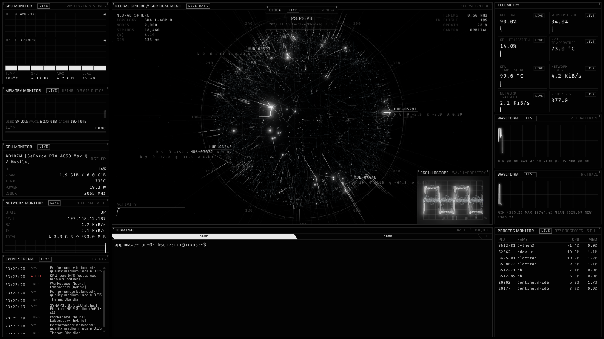
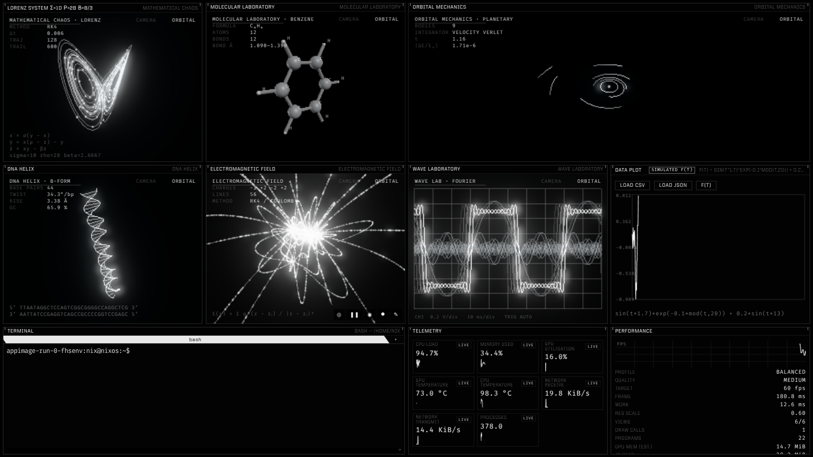

# SYNAPSE-UI

A modular neural visualization and terminal workstation, built as a GPLv3 fork of [eDEX-UI](https://github.com/GitSquared/edex-ui). Dense technical panels, thin borders, real shells, and a black scientific workspace. **3.0.0-alpha.1 is an early release:** Linux is the development platform; Windows and macOS packaging is automated but desktop behavior still needs validation.

## Screenshots

Actual application captures at 1600×900; no mockups.




## Features

- Real PTYs and xterm.js terminals, tabs, splits, search, clipboard, shell detection.
- Grid, freeform, and hybrid layouts with drag/resize, grouping, layering, pinning, undo/redo and saved profiles.
- Live CPU, RAM, GPU, network, storage, process and connection monitoring. Unavailable measurements are reported as unavailable.
- Eight coordinated themes, per-module overrides, live theme and animation editors.
- Validated TOML configuration, backups, live reload and GUI synchronization.
- Sandboxed extensions with explicit permission approval.

## Neural visualization

Neural Sphere combines worker-generated networks, shader-driven pulses, dense fine connections, rotating cameras and configurable trails/bloom. These are artistic simulations, not a trained neural model or measurements of neural activity.

## Terminals

Shells run with your account's permissions. Terminal sessions survive workspace switches. The `synapse` helper controls the app from its own terminals without a localhost service:

```sh
synapse help
synapse theme set terminal-green
synapse workspace switch scientific
synapse animation load particle-ocean
```

## Workspaces

Built-ins: Classic eDEX, Neural Laboratory, Cybersecurity, Scientific Research, Cinematic, Custom. Press **Ctrl+Shift+E** to edit; move/resize modules, change layout mode, duplicate, group and save. Each profile retains its layout. Settings and the command palette expose profile creation and switching.

## Animation modules

36 presets across 15 rendering engines: neural sphere/graph, particles, attractors, field lines, raymarch, DNA helix, molecule, waves, orbital, matrix, circuits, hologram, grid surface and ENCOM Globe+. Globe+ retains eDEX's geographic grid data and visual lineage; decorative arcs are not IP geolocation. See [graphics](docs/GRAPHICS.md).

## Performance modes

Eco (30 FPS cap), Balanced (60), High (120), Cinematic (144), Adaptive. These are caps, not promised frame rates. Battery saver, resolution scaling, visibility suspension and adaptive quality reduce load. See [measured benchmarks](docs/BENCHMARKS.md).

## Installation

Get platform artifacts from [Releases](https://github.com/SwashX-dev/Synapse-UI/releases). Linux: AppImage, deb, rpm or tar.gz; Windows: NSIS or portable; macOS: dmg/zip. Windows/macOS packages are unsigned. Check release checksums before installing.

```sh
chmod +x SYNAPSE-UI-*.AppImage
./SYNAPSE-UI-*.AppImage
```

## NixOS

```sh
nix run github:SwashX-dev/Synapse-UI/main
# Or from a checkout:
nix build
./result/bin/synapse-ui
```

For AppImage use `appimage-run`. The flake uses nixpkgs Electron, avoiding incompatible generic Linux binaries. Proprietary GPU drivers must be configured by the host. See [troubleshooting](docs/TROUBLESHOOTING.md).

## Development

```sh
git clone https://github.com/SwashX-dev/Synapse-UI.git
cd Synapse-UI
git switch main
nix develop  # NixOS; other platforms need Node 24, Python and a C++ toolchain
npm ci
npm start
```

## Configuration

Settings are generated in `~/.config/synapse-ui/config.toml` on Linux. GUI changes write to disk; valid external edits apply live. `SYNAPSE_CONFIG_DIR` selects an isolated directory. The [configuration guide](docs/CONFIGURATION.md) covers paths, validation and backups.

## Keyboard shortcuts

| Action | Shortcut |
| --- | --- |
| Palette / settings | Ctrl+Shift+P / Ctrl+Shift+S |
| Workspace editor | Ctrl+Shift+E |
| Theme / animation editor | Ctrl+Shift+T / Ctrl+Shift+A |
| Module manager | Ctrl+Shift+M |
| Pause / diagnostics | Ctrl+Shift+Space / Ctrl+Shift+D |
| Terminal tab / search | Ctrl+Shift+N / Ctrl+Shift+F |
| Fullscreen | F11 |

Bindings are editable in Settings and `keybindings.toml`. See [full reference](docs/KEYBINDINGS.md).

## Themes

Obsidian, eDEX Classic, Crimson Protocol, Cybernetic Blue, Terminal Green, Ultraviolet, Ghost White, Custom. Color, typography, effects, terminal palette, spacing and per-module overrides apply live. [Theme guide](docs/THEMES.md).

## Modules and extensions

Install local folders through the Module Manager; review and approve requested permissions before enabling. Declarative panels, preset packs, themes and isolated script frames are supported. No automatic downloads or script execution. [API and examples](docs/MODULE_API.md).

## Recording and audio

The animation editor exports PNG, PNG sequences, WebM and GIF; MP4 requires `ffmpeg` on PATH. Audio files and explicitly authorized microphone input can drive parameters. System audio capture varies by OS and compositor; it is not universally available.

## Architecture

Electron main handles privileged services; a narrow isolated preload exposes validated operations. Renderer modules share one WebGL2 renderer and worker-generated geometry. [Architecture](docs/ARCHITECTURE.md).

## Security

The original unauthenticated WebSocket terminal server is removed. Shell traffic uses validated Electron IPC and the helper uses a per-session authenticated OSC sequence. Renderer Node integration is disabled; context isolation and sandbox are enabled. See [security model](docs/SECURITY.md) and [reporting policy](SECURITY.md).

## Tests and builds

```sh
npm run lint
npm run typecheck
npm test
npm run rebuild:native
xvfb-run -a npm run test:e2e  # Linux headless; omit wrapper on desktop Windows/macOS
npm run audit:deps
npm run dist:linux          # dist:win / dist:mac on their native hosts
```

CI tests Linux; package workflows build each OS natively. [Build guide](docs/BUILDING.md).

## Known limitations

See [limitations](docs/LIMITATIONS.md): alpha stability, platform validation, renderer workload, unsigned packages, system audio, extension trust and migration differences. Do not use this alpha as your only terminal for critical operations.

## Contributing and license

Read [CONTRIBUTING](CONTRIBUTING.md), [changelog](CHANGELOG.md), and [migration](docs/MIGRATION.md). GPL-3.0; original copyright and full history retained. SYNAPSE-UI is an independent continuation, not endorsed by the original authors. eDEX-UI by Gabriel “Squared” Saillard and its contributors supplies the foundation, typography, audio, keyboard layouts and globe data. Included third-party libraries retain their licenses; production bundles emit linked license comments.
